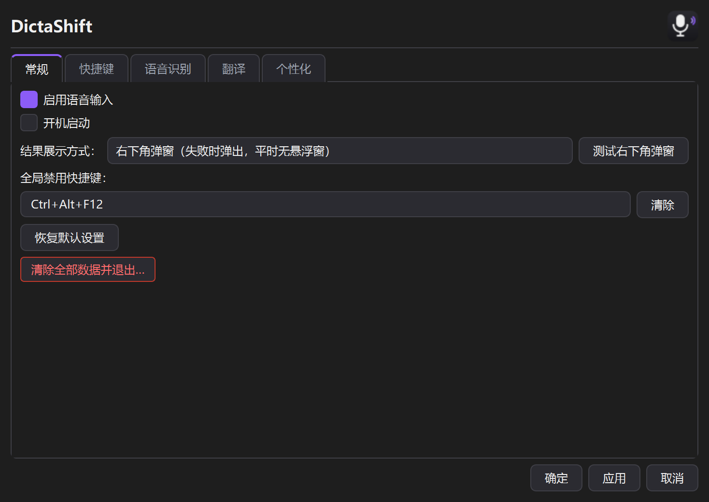
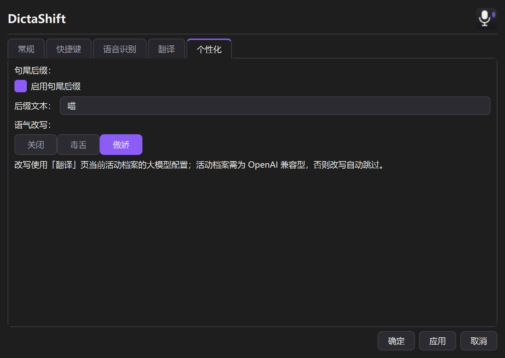
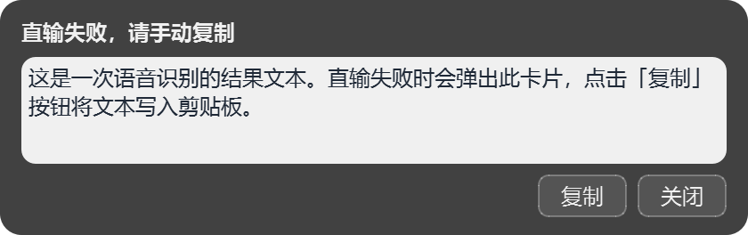

<div align="center">

# 🎙️ DictaShift（语键）

**按住说话，松开即写——Windows 常驻语音输入工具**

按住 `F8` 中文听写 · 按住 `F9` 中文转英文 · 结果直接输入光标处

[](LICENSE)
[](https://github.com/yuchen-ya/dictashift)
[](https://www.python.org/)
[](https://github.com/yuchen-ya/dictashift/releases)

[English](#english) · [功能特性](#-功能特性) · [安装](#-安装) · [快捷键](#-快捷键) · [隐私](#-隐私说明) · [开发](#-开发)

</div>

---

语音识别的**全部计算在本地完成**（基于 [FunASR](https://github.com/modelscope/FunASR) 的 SenseVoice ONNX int8 模型），不依赖云端 ASR；
翻译可使用**免登录**的 Google / Bing，或任意 OpenAI 兼容接口（含本地 llama-server）。

## ✨ 功能特性

| 功能 | 说明 |
| --- | --- |
| 🎤 本地语音识别 | SenseVoice ONNX int8 本地推理，音频不出本机 |
| 🌐 多翻译后端 | 内置免登录 Google / Bing（限流自动互切），OpenAI 兼容接口，本地 llama-server 预设 |
| ⌨️ 光标直输 | 结果直接键入光标处（不占用剪贴板）；无输入焦点（桌面/任务栏）自动识别并走弹窗/悬浮窗兜底，点击才复制 |
| 🪟 状态悬浮窗 | 可选常驻置顶单行卡片，宽度随内容自适应；直输失败时显示结果文本，点击卡片即复制 |
| 🚦 状态如实反馈 | 「◌ 准备中 / ● 录音中」由首个音频帧驱动——麦克风真正开始收音才亮红灯；错误在弹窗/悬浮窗可见提示，绝不静默 |
| ⚡ 低延迟流水线 | 热键事件异步化，松手即停；高效多相重采样，说完即出字 |
| 🔁 状态机流水线 | 准备 → 录音 → 识别 → 翻译 → 改写 → 输出，禁用/取消/错误全路径可恢复 |
| 🎀 个性化输出 | 句尾后缀逐句插入（默认「喵」，纯字符串不走大模型）；语气改写（关闭/毒舌/傲娇）复用翻译页 OpenAI 兼容档案，改写失败静默回退原文 |
| 🎨 图标与主题 | 全套程序生成的扁平麦克风图标（窗口/任务栏/托盘统一），深色主题美化设置窗口 |
| 📥 模型自动下载 | 首次运行一键从 GitHub Releases 下载模型（SHA256 校验） |
| 🚀 开机自启 | 一键开关（注册表 Run 项） |
| 🧹 一键清除数据 | 设置面板「清除全部数据并退出」，卸载前彻底删除 API Key / 日志 / 模型 |
| 🔒 隐私优先 | 无遥测，日志不含 API Key 与翻译内容 |

## 🖼️ 界面预览

<div align="center">

<br/><em>翻译设置：内置免登录服务与 OpenAI 兼容配置平级选择</em>
<br/><br/>
&nbsp;&nbsp;

<br/><em>常规：结果展示方式与一键清除数据；快捷键：全部热键可自定义</em>
<br/><br/>
&nbsp;&nbsp;

<br/><em>语音识别：模型一键下载与麦克风选择；个性化：句尾后缀与语气改写（关闭/毒舌/傲娇）</em>
<br/><br/>
&nbsp;&nbsp;
&nbsp;&nbsp;
&nbsp;&nbsp;

<br/><em>状态悬浮窗：◌ 准备中（橙，麦克风预热）→ ● 录音中（红，真正在收音）→ 改写中（紫，语气改写）；直输失败时结果直接替换状态文字，点击卡片即复制</em>
<br/><br/>

<br/><em>右下角结果弹窗（直输失败时弹出，点击「复制」才写入剪贴板）</em>
</div>

## ⌨️ 快捷键

默认绑定（可在「设置 - 快捷键」中修改）：

| 动作 | 默认快捷键 | 说明 |
| --- | --- | --- |
| 中文听写 | `F8` | 按住开始录音，松开识别并输入中文到光标处 |
| 中文转英文 | `F9` | 按住开始录音，松开识别中文并翻译成英文输入 |
| 启用/暂停 | `Ctrl+Alt+F12` | 切换全局启用状态 |
| 取消 | `Esc` | 录音/识别中取消当前任务 |

在「设置 → 语音识别」开启「即按即录」，可省去每次按键时启动麦克风的等待。该选项默认关闭。开启后，语音输入启用期间麦克风保持打开，仅保留按住听写键期间的音频。暂停语音输入或退出会关闭麦克风。

## 🚀 安装

### 方式一：发布包（推荐）

1. 到 [Releases](https://github.com/yuchen-ya/dictashift/releases) 下载最新的 `DictaShift-<version>-windows.zip`；
2. 解压到任意目录，双击运行 `DictaShift.exe`；
3. 首次运行打开「设置 - 语音识别」，点击「下载模型」（约 230 MB，自动校验完整性）；
4. 完成，按住 `F8` 即可开始听写。

### 方式二：源码运行

需要 Python 3.11 与 [uv](https://docs.astral.sh/uv/)：

```bash
git clone https://github.com/yuchen-ya/dictashift.git
cd dictashift
uv sync
uv run python -m dictashift
# 首次运行后在「设置 - 语音识别」页下载模型
```

## 🌐 翻译配置

| 类型 | 说明 |
| --- | --- |
| Google 翻译（免费） | 内置，免登录，无需任何配置 |
| Bing 翻译（免费） | 内置，免登录；免费服务限流时自动切换到另一家重试 |
| OpenAI 兼容 API | 自填 `base_url` / `model` / `api_key`，支持云端服务与本地 [llama-server](https://github.com/ggml-org/llama.cpp)（预设 `http://127.0.0.1:19120/v1`） |

## 🔒 隐私说明

- 音频**仅在本地处理**：录音、SenseVoice 推理全部在本地完成，不上传音频。即按即录模式会丢弃空闲音频帧；
- 翻译文本会发送到你所选择的翻译服务；如需完全离线，请使用本地 llama-server；
- 配置文件与模型存放在 `%APPDATA%\DictaShift\`，**不收集任何遥测**；
- **API Key**：以明文保存在 `settings.json`（此类桌面客户端的普遍做法），请勿在共享机器上存放高权限 Key；
- **日志**：写入 `%APPDATA%\DictaShift\logs\`，不含 API Key、Authorization 头与翻译响应内容；
- **全局键盘钩子**：全局快捷键需要监听按键按下/松开事件（pynput），仅在快捷键边沿触发动作，不记录、不外传任何按键序列；部分杀毒软件可能对此告警，属正常现象；
- **卸载前清理**：本程序为便携 zip 分发，无卸载程序，删除应用文件夹不会清理 `%APPDATA%\DictaShift\`。卸载前可在设置面板点击「清除全部数据并退出…」一键删除该目录（含 API Key、日志、已下载模型）。

## 🛠️ 开发

```bash
uv sync
uv run pytest                 # 460+ 用例（硬件相关测试默认跳过）
uv run python -m dictashift   # 运行
uv run python scripts/build.py  # 打包（PyInstaller → dist/DictaShift）
```

<details>
<summary>目录结构</summary>

```text
src/dictashift/
├── core/          # 状态机 + 流水线控制器
├── hotkeys/       # 全局快捷键（pynput）
├── audio/         # 录音（sounddevice）+ 重采样
├── asr/           # SenseVoice ONNX 引擎 + 设备管理 + 模型下载
├── translation/   # OpenAI 兼容 / Google / Bing 后端 + 限流切换
├── output/        # SendInput 光标直输 + 剪贴板
├── settings/      # 配置持久化 + 开机自启
└── ui/            # 托盘 / 设置窗口 / 悬浮窗 / 结果弹窗
```

</details>

### 发布维护（维护者）

1. `uv run python scripts/build.py` 构建，将 `dist/DictaShift` 压缩为 `DictaShift-<version>-windows.zip`；
2. 创建对应 tag 的 Release，上传 Windows 压缩包；
3. 只有模型变更时才需要上传新的模型包。将三个模型文件放在 zip 根目录，并同步更新下载地址、文件大小和 SHA256（见 [模型下载代码](src/dictashift/asr/model_download.py)）。现有模型沿用 v0.2.0 的发布资产。

## 🗺️ Roadmap

- [ ] macOS (ARM) 支持

## English

DictaShift is a Windows background dictation tool: hold **F8** to dictate Chinese, hold **F9** to dictate Chinese and input English translation, release to type the result at the cursor. Speech recognition runs **entirely on-device** (SenseVoice ONNX int8, from FunASR); translation works with login-free Google/Bing or any OpenAI-compatible endpoint (including local llama-server). Optional personalization: per-sentence suffix insertion and tone rewriting (off / sarcastic / tsundere) reusing your OpenAI-compatible profile. No telemetry. MIT License.

## 📄 License

[MIT](LICENSE) © 2026 yuchen-ya

语音识别模型来自 [FunASR](https://github.com/modelscope/FunASR)（SenseVoice），其许可以官方仓库为准。
