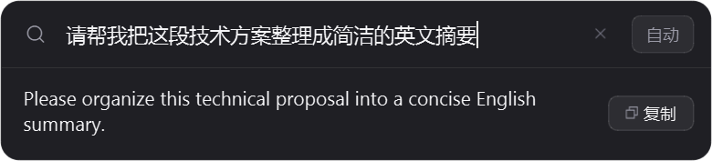
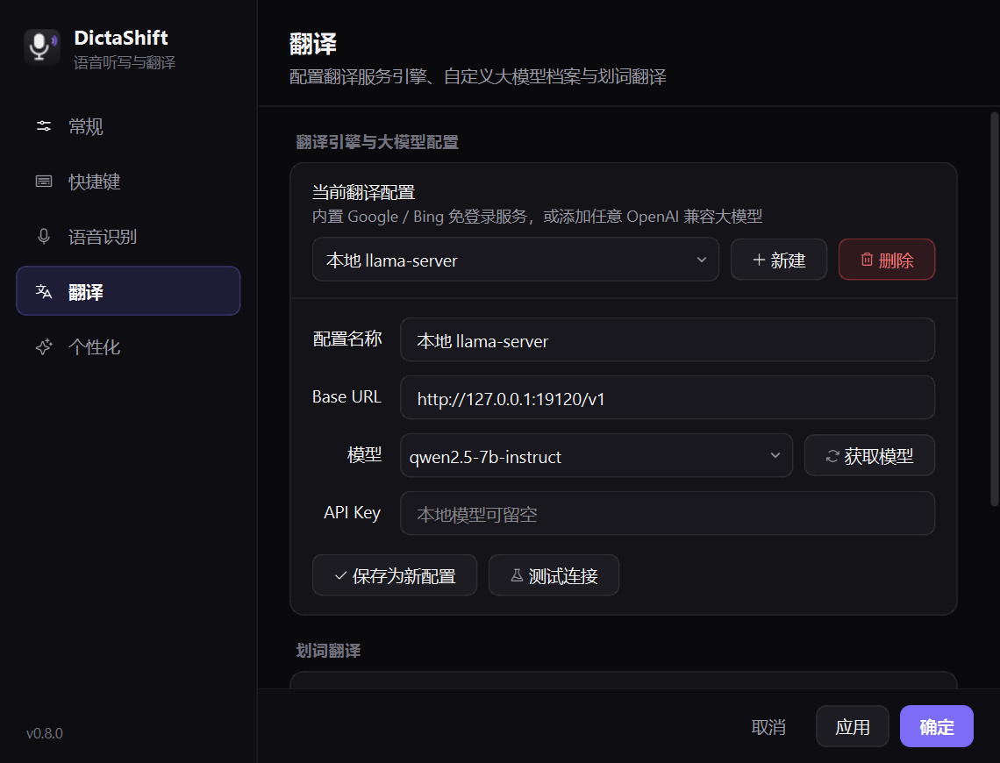
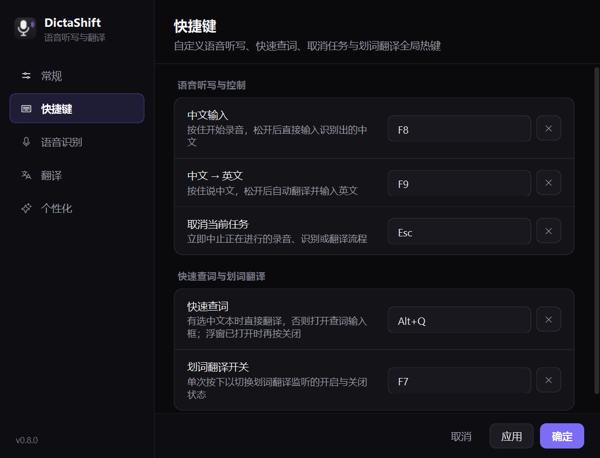
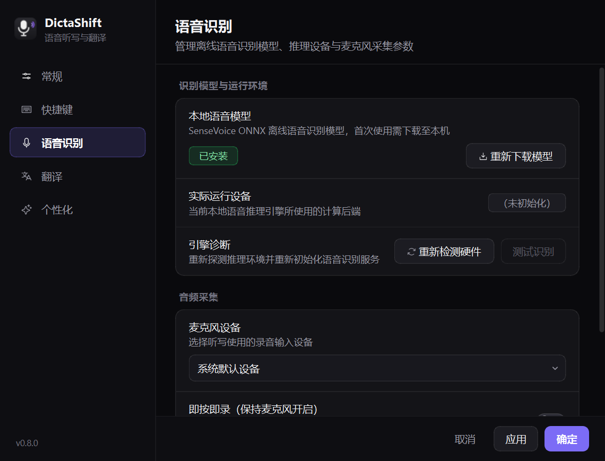

<div align="center">

# 🎙️ DictaShift（语键）

**按住说话，松开即写——Windows 常驻语音输入与翻译工具**

按住 `F8` 中文听写 · 按住 `F9` 中文转英文 · `F7` 划词翻译 · `Alt+Q` 智能快速查词

[](LICENSE)
[](https://github.com/yuchen-ya/dictashift)
[](https://www.python.org/)
[](https://github.com/yuchen-ya/dictashift/releases)

[English](#english) · [功能特性](#-功能特性) · [界面预览](#-界面预览) · [快捷键](#-快捷键) · [安装](#-安装) · [隐私](#-隐私说明) · [开发](#-开发)

</div>

---

语音识别的**全部计算在本地完成**（基于 [FunASR](https://github.com/modelscope/FunASR) 的 SenseVoice ONNX int8 模型），不依赖云端 ASR；
翻译与查词可使用**免登录**的 Google / Bing，或任意 OpenAI 兼容接口（含本地 llama-server）。

## ✨ 功能特性

| 功能 | 说明 |
| --- | --- |
| 🎤 本地语音识别 | SenseVoice ONNX int8 本地推理，音频不出本机 |
| 🔍 快速查词（`Alt+Q`） | 智能热键：有选中文本时直接翻译，否则打开居中极简两段式 Spotlight 查词浮窗；支持点击循环切换方向（`自动` / `中→英` / `英→中`）、防抖与 `Enter` 立即翻译、一键复制（`Ctrl+Shift+C`）、失焦/Esc/热键自动关闭与托盘入口 |
| 📖 划词翻译（`F7`） | 一键开关鼠标划词浮动翻译，选中文本自动弹出深色译文卡片，支持自动收起与点击复制 |
| 🌐 多翻译后端 | 内置免登录 Google / Bing（限流自动互切）；OpenAI 兼容接口支持 `/models` 自动/手动拉取可编辑下拉框、默认不发送 `temperature`、默认关闭思考模式（HTTP 400/422 静默降级缓存 + `<think>`/`<thought>` 标签剥离）及本地 llama-server 预设 |
| ⌨️ 光标直输 | 结果直接键入光标处（不占用剪贴板）；无输入焦点（桌面/任务栏）自动识别并走弹窗/悬浮窗兜底，点击才复制 |
| 🪟 状态悬浮窗 | 可选常驻置顶单行卡片，宽度随内容自适应；直输失败时显示结果文本，点击卡片即复制 |
| 🚦 状态如实反馈 | 「◌ 准备中 / ● 录音中」由首个音频帧驱动——麦克风真正开始收音才亮红灯；错误在弹窗/悬浮窗可见提示，绝不静默 |
| ⚡ 低延迟流水线 | 热键事件异步化，松手即停；高效多相重采样，说完即出字 |
| 🔁 状态机流水线 | 准备 → 录音 → 识别 → 翻译 → 改写 → 输出，禁用/取消/错误全路径可恢复 |
| 🎀 个性化输出 | 句尾后缀逐句插入（默认「喵」，纯字符串不走大模型）；语气改写（关闭/毒舌/傲娇）复用翻译页 OpenAI 兼容档案，改写失败静默回退原文 |
| 🎨 界面设计 | Shadcn / Raycast 风格深色 UI（左侧导航 + 分组卡片、自定义 `ToggleSwitch` / `SegmentedControl`）、`qtawesome` Phosphor 矢量图标、`pywinstyles` Windows 原生暗色标题栏，全套应用图标统一呈现 |
| 📥 模型自动下载 | 首次运行一键从 GitHub Releases 下载模型（SHA256 校验） |
| 🚀 开机自启 | 一键开关（注册表 Run 项） |
| 🧹 一键清除数据 | 设置面板「清除全部数据并退出」，卸载前彻底删除 API Key / 日志 / 模型 |
| 🔒 隐私优先 | 无遥测，日志不含 API Key 与翻译内容 |

## 🖼️ 界面预览

<div align="center">

<br/><em>快速查词浮窗（Alt+Q）：极简两段式 Spotlight 居中浮窗，支持方向一键循环切换与快捷复制</em>
<br/><br/>

<br/><em>翻译设置：内置免登录服务与 OpenAI 兼容配置平级选择，支持 /models 一键获取模型列表与划词翻译配置</em>
<br/><br/>
&nbsp;&nbsp;

<br/><em>常规：结果展示方式与一键清除数据；快捷键：语音听写、快速查词与划词翻译热键均可自定义</em>
<br/><br/>
&nbsp;&nbsp;

<br/><em>语音识别：模型一键下载与麦克风选择；个性化：句尾后缀与语气改写（关闭/毒舌/傲娇）</em>
<br/><br/>
&nbsp;&nbsp;
&nbsp;&nbsp;
&nbsp;&nbsp;

<br/><em>状态悬浮窗：◌ 准备中（橙，麦克风预热）→ ● 录音中（红，真正在收音）→ 改写中（紫，语气改写）；直输失败时结果直接替换状态文字，点击卡片即复制</em>
<br/><br/>

<br/><em>右下角结果弹窗（直输失败时弹出，点击「复制」才写入剪贴板）</em>
</div>

## ⌨️ 快捷键

默认绑定（可在「设置 - 快捷键」中修改）：

| 动作 | 默认快捷键 | 说明 |
| --- | --- | --- |
| 中文听写 | `F8` | 按住开始录音，松开识别并输入中文到光标处 |
| 中文转英文 | `F9` | 按住开始录音，松开识别中文并翻译成英文输入 |
| 快速查词 | `Alt+Q` | 智能热键：有选中文本时直接翻译，否则打开居中查词浮窗；弹窗已打开时再按关闭 |
| 划词翻译开关 | `F7` | 单次按下切换鼠标划词浮动翻译监听的开启与关闭 |
| 启用/暂停 | `Ctrl+Alt+F12` | 切换全局语音输入启用状态 |
| 取消 | `Esc` | 录音/识别中取消当前任务（在快速查词浮窗中关闭弹窗） |

在「设置 → 语音识别」开启「即按即录」，可省去每次按键时启动麦克风的等待。该选项默认关闭。开启后，语音输入启用期间麦克风保持打开，仅保留按住听写键期间的音频。暂停语音输入或退出会关闭麦克风。

## 🚀 安装

### 方式一：发布包（推荐）

1. 到 [Releases](https://github.com/yuchen-ya/dictashift/releases) 下载最新的 `DictaShift-<version>-windows.zip`；
2. 解压到任意目录，双击运行 `DictaShift.exe`；
3. 首次运行打开「设置 - 语音识别」，点击「下载模型」（约 230 MB，自动校验完整性）；
4. 完成，按住 `F8` 即可开始听写，按 `Alt+Q` 随时快速查词。

### 方式二：源码运行

需要 Python 3.11 与 [uv](https://docs.astral.sh/uv/)：

```bash
git clone https://github.com/yuchen-ya/dictashift.git
cd dictashift
uv sync
uv run python -m dictashift
# 首次运行后在「设置 - 语音识别」页下载模型
```

## 🌐 翻译配置

| 类型 | 说明 |
| --- | --- |
| Google 翻译（免费） | 内置，免登录，选中时自动隐藏自定义表单，零配置开箱即用 |
| Bing 翻译（免费） | 内置，免登录；免费服务限流时自动切换到另一家重试 |
| OpenAI 兼容 API | 支持云端服务与本地 [llama-server](https://github.com/ggml-org/llama.cpp)（预设 `http://127.0.0.1:19120/v1`），填写 `Base URL` / `API Key` 后支持自动或手动从 `/models` 拉取模型列表至可编辑下拉框 |

OpenAI 兼容后端内置多项健壮性优化：

- **默认不发送 `temperature` 参数**：避免推理模型或严格网关报参错（旧配置中已有数值仍完全向后兼容）；
- **默认关闭思考模式**：按模型/服务端智能优先尝试关闭思考参数，遇 HTTP `400` / `422` 自动静默降级并按接口缓存结果，同时在流式输出阶段兜底剥离 `<think>` / `<thought>` 标签并忽略 `reasoning_content`。

## 🔒 隐私说明

- 音频**仅在本地处理**：录音、SenseVoice 推理全部在本地完成，不上传音频。即按即录模式会丢弃空闲音频帧；
- 翻译与查词文本会发送到你所选择的翻译服务；如需完全离线，请使用本地 llama-server；
- 配置文件与模型存放在 `%APPDATA%\DictaShift\`，**不收集任何遥测**；
- **API Key**：以明文保存在 `settings.json`（此类桌面客户端的普遍做法），请勿在共享机器上存放高权限 Key；
- **日志**：写入 `%APPDATA%\DictaShift\logs\`，不含 API Key、Authorization 头与翻译响应内容；
- **全局键盘钩子**：全局快捷键需要监听按键按下/松开事件（pynput），仅在快捷键边沿触发动作，不记录、不外传任何按键序列；部分杀毒软件可能对此告警，属正常现象；
- **卸载前清理**：本程序为便携 zip 分发，无卸载程序，删除应用文件夹不会清理 `%APPDATA%\DictaShift\`。卸载前可在设置面板点击「清除全部数据并退出…」一键删除该目录（含 API Key、日志、已下载模型）。

## 🛠️ 开发

```bash
uv sync
uv run pytest                   # 800+ 用例（硬件相关测试默认跳过）
uv run python -m dictashift     # 运行
uv run python scripts/build.py  # 打包（PyInstaller → dist/DictaShift）
```

<details>
<summary>目录结构</summary>

```text
src/dictashift/
├── application.py     # 应用装配层、信号桥接与业务路由
├── main.py            # 应用入口与单实例/日志初始化
├── resources.py       # 打包态与源码态资源路径解析
├── core/              # 状态机 + 流水线控制器
├── hotkeys/           # 全局快捷键监听与匹配（pynput）
├── audio/             # 录音（sounddevice）+ 设备枚举 + 重采样
├── asr/               # SenseVoice ONNX 引擎 + 设备管理 + 模型下载
├── translation/       # OpenAI 兼容（/models + 思考关闭降级）/ Google / Bing + 限流切换 + 语种检测
├── personalize/       # 句尾后缀 + LLM 语气改写
├── selection/         # 划词监听 + 剪贴板备份恢复 + 选区捕获
├── output/            # SendInput 光标直输 + 焦点检测 + 剪贴板
├── settings/          # 配置模型与持久化 + Windows 开机自启
└── ui/                # 暗色设计系统与界面组件
    ├── theme.py               # Shadcn / Raycast 暗色 Token 与全局 QSS
    ├── icons.py               # qtawesome Phosphor 矢量图标封装
    ├── widgets.py             # ToggleSwitch / SegmentedControl / SettingSection / 原生暗色标题栏
    ├── settings_window.py     # 左侧导航 + 分组卡片设置窗口
    ├── quick_lookup_popup.py  # Alt+Q Spotlight 风格居中快速查词浮窗
    ├── selection_popup.py     # 划词翻译浮动卡片
    ├── overlay.py             # 常驻状态悬浮窗
    ├── result_popup.py        # 直输失败右下角结果弹窗
    ├── hotkey_editor.py       # 快捷键录制控件
    └── tray.py                # 系统托盘图标与菜单
```

</details>

### 发布维护（维护者）

1. `uv run python scripts/build.py` 构建，将 `dist/DictaShift` 压缩为 `DictaShift-<version>-windows.zip`；
2. 创建对应 tag 的 Release，上传 Windows 压缩包；
3. 只有模型变更时才需要上传新的模型包。将三个模型文件放在 zip 根目录，并同步更新下载地址、文件大小和 SHA256（见 [模型下载代码](src/dictashift/asr/model_download.py)）。现有模型沿用 v0.2.0 的发布资产。

## 🗺️ Roadmap

- [ ] macOS (ARM) 支持

## English

DictaShift is a Windows background voice dictation and translation tool: hold **F8** to dictate Chinese, hold **F9** to dictate Chinese and input English translation, press **F7** to toggle mouse-selection translation, or press **Alt+Q** for smart quick lookup (translates selected text directly, or opens a minimalist two-tier Spotlight-style zh↔en lookup popup with direction cycling and one-click copy). Speech recognition runs **entirely on-device** (SenseVoice ONNX int8, from FunASR); translation works with login-free Google/Bing (automatic failover) or any OpenAI-compatible endpoint (including local llama-server, with `/models` discovery, no `temperature` parameter sent by default, and automatic thinking-disabled fallback + tag stripping). Features a Shadcn/Raycast-inspired dark UI, optional per-sentence suffix and tone rewriting (off / sarcastic / tsundere), and zero telemetry. MIT License.

## 📄 License

[MIT](LICENSE) © 2026 yuchen-ya

语音识别模型来自 [FunASR](https://github.com/modelscope/FunASR)（SenseVoice），其许可以官方仓库为准。
